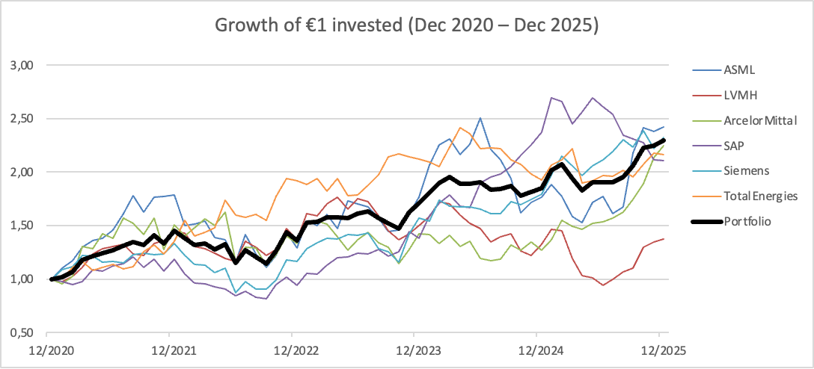

# European Equity Portfolio and Risk Analysis

Personal project testing whether diversification reduces risk on real market data.

## Data and method
- Monthly adjusted closing prices (December 2020 – December 2025) for six large European stocks: ASML, SAP, LVMH, Siemens, TotalEnergies and ArcelorMittal.
- Data downloaded from Yahoo Finance with a short Python script (`download_prices.py`).
- Excel model comparing each stock with an equal-weight portfolio (1/6 in each stock, rebalanced monthly).
- Indicators: annualised return, volatility, Sharpe ratio, correlations, maximum drawdown and 95% Value at Risk (historical method).

## Key results
| | Annual return | Volatility | Sharpe ratio | Max. drawdown | VaR 95% (monthly) |
|---|---|---|---|---|---|
| Best stock (Sharpe) – TotalEnergies | 17.8% | 21.6% | 0.82 | −21.3% | −8.2% |
| Average of the six stocks | 18.4% | 27.3% | 0.68 | | |
| **Equal-weight portfolio** | **18.4%** | **18.6%** | **0.99** | **−21.2%** | **−5.6%** |

The portfolio earned the stocks' average return with lower volatility than any single stock, the best Sharpe ratio and the smallest maximum drawdown.

## Files
- `European_Equity_Portfolio_and_Risk_Analysis.xlsx`: full Excel model with notes
- `European_Equity_Portfolio_and_Risk_Analysis.pdf`: three-page synthesis (method, results, limitations)
- `download_prices.py`: data download script

## Limitations
Small sample, selection bias, 0% risk-free rate, no transaction costs. See the synthesis for details.

*David Prates Marinho – November 2026*
